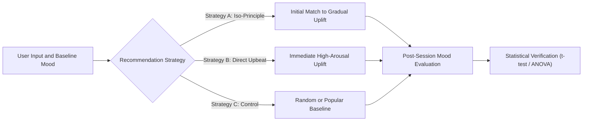
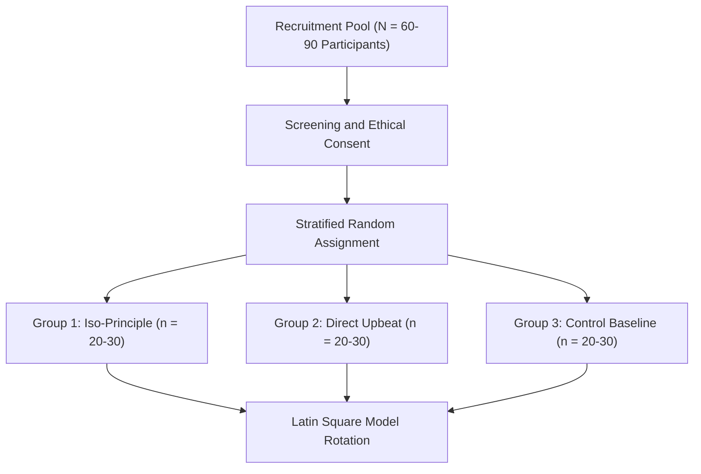
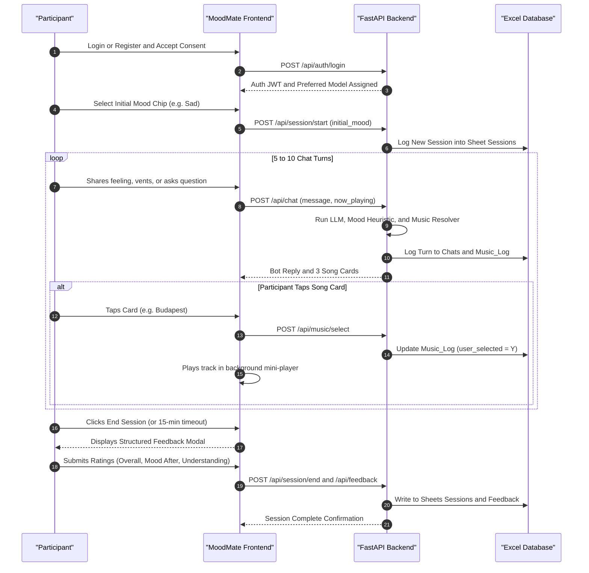
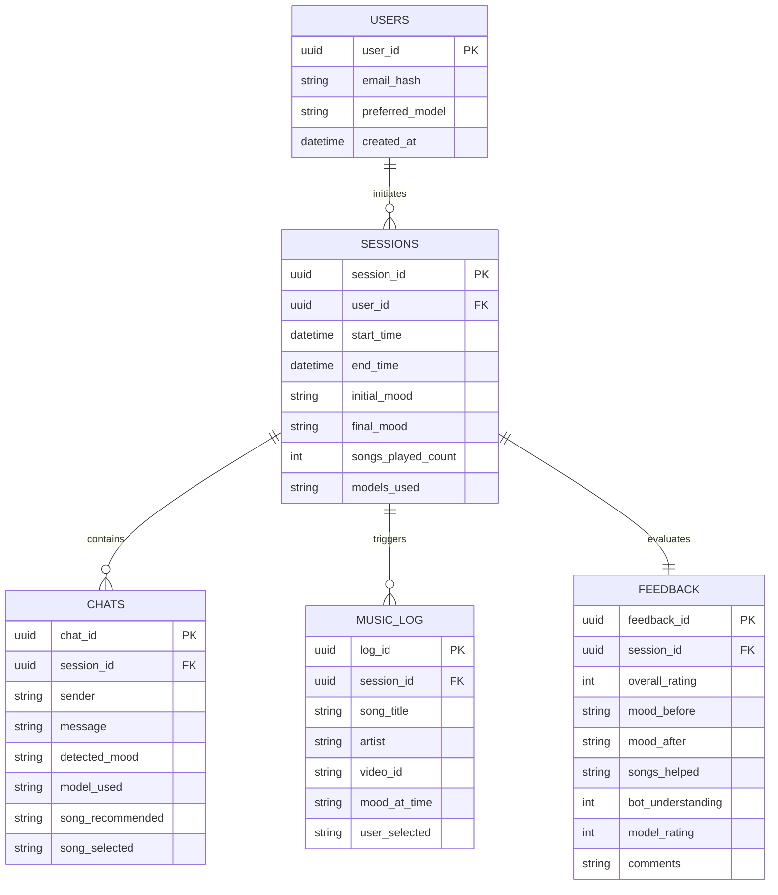

# MoodMate: Empirical Experiment Design & Evaluation Framework

> **Document Type:** Research & Experimental Evaluation Protocol  
> **System Under Test:** MoodMate (Conversational AI Companion with Iso-Principle Music Recommendation)  
> **Authors/Researchers:** Nikhil Yadav & Engineering Team  
> **Target Scope:** Human-Computer Interaction (HCI), Affective Computing & Applied AI Evaluation  

---

## 1. Executive Summary & Purpose

This document outlines the formal **experimental design** to evaluate **MoodMate**, an empathetic AI chatbot integrating conversational empathy with real-time mood detection, continuous background music playback, and mood-adaptive song curation grounded in the **iso-principle** (matching a user's current affective state before gradually transitioning toward an uplifted valence).

The goal of this evaluation is to empirically measure:
1. **Affective Efficacy:** Does the iso-principle music transition lead to statistically significant positive mood shifts compared to baseline recommendation approaches?
2. **Conversational Quality & Empathy:** How do local open-weights LLMs (Ollama Llama 3.2 3B) compare against high-parameter cloud models (Groq Llama 3.3 70B, Google Gemini 2.0 Flash) in perceived empathy, contextual understanding, and multilingual coherence?
3. **User Engagement & Agency:** How does conversational music recommendation with background streaming affect session engagement and song acceptance rates compared to static playlist recommenders?

---

## 2. Research Questions (RQs) & Formal Hypotheses

### **RQ1: Affective Regulation via the Iso-Principle**
* **Question:** Does recommending songs matching the user's initial mood followed by gradual mood-elevating tracks (the iso-principle) produce superior emotional regulation compared to immediately forcing cheerful/upbeat songs?
* **Hypothesis $H_1$:** Participants in the **Iso-Principle condition** will demonstrate a significantly higher positive mood shift ($\Delta \text{Mood} = \text{Mood}_{\text{post}} - \text{Mood}_{\text{pre}}$) than participants presented with immediate upbeat recommendations.
* **Null Hypothesis $H_0$:** There is no significant difference in mood shift between iso-principle and direct upbeat recommendation strategies.

### **RQ2: LLM Architecture & Perceived Companion Empathy**
* **Question:** What is the tradeoff between edge/local offline models (Ollama Llama 3.2 3B / Built-in Companion) and large cloud models (Llama 3.3 70B, Gemini 2.0 Flash) across perceived empathy, conversational coherence, and response latency?
* **Hypothesis $H_2$:** Cloud models (Groq Llama 3.3 70B / Gemini 2.0) will yield significantly higher *Bot Understanding* scores (1–5) and lower hallucination rates than compact 3B edge models, but local/built-in models will achieve significantly higher perceived *Privacy Confidence* and zero latency variance.

### **RQ3: Multilingual & Cultural Coherence**
* **Question:** Does conversational mirroring in regional languages (Hindi, Bengali, and Hinglish) enhance song card click-through rates and perceived connection compared to English-only interactions?
* **Hypothesis $H_3$:** Users conversing in their native/preferred language (Hindi/Bengali/Hinglish) will exhibit higher song selection ratios ($S_{\text{selected}} / S_{\text{recommended}}$) and session retention when songs and explanations align culturally.

---

## 3. Experimental Variables

| Variable Class | Variable Name | Type | Operational Definition / Measurement |
| :--- | :--- | :--- | :--- |
| **Independent (IV 1)** | **Music Transition Strategy** | Categorical (3 levels) | • Condition 1: **Iso-Principle** (Match $\rightarrow$ Moderate Uplift $\rightarrow$ Positive Uplift) • Condition 2: **Direct Upbeat** (Always recommend high valence/arousal songs) • Condition 3: **Control** (Popular songs without mood alignment) |
| **Independent (IV 2)** | **AI Brain Model** | Categorical (3 levels) | • Model A: `ollama/llama3.2` (Local 3B edge inference) • Model B: `groq/llama-3.3-70b-versatile` (Cloud open weights) • Model C: `gemini/gemini-2.0-flash` (Cloud multimodal LLM) |
| **Independent (IV 3)** | **Interaction Language** | Categorical (3 levels) | English, Hindi (or Hinglish), Bengali |
| **Dependent (DV 1)** | **Mood Shift ($\Delta \text{Mood}$)** | Continuous / Ordinal | Measured via Self-Assessment Manikin (SAM) / 5-point Emoji scale ($\text{Mood}_{\text{final}} - \text{Mood}_{\text{initial}}$) |
| **Dependent (DV 2)** | **Music Helpful Score** | Categorical / Ordinal | Survey response: *"Did the songs help?"* (1 = No, 2 = Somewhat, 3 = Yes) |
| **Dependent (DV 3)** | **Perceived Bot Understanding** | 5-point Likert | Survey question: *"Did the bot understand you?"* (1 = Not at all, 5 = Completely) |
| **Dependent (DV 4)** | **Song Selection Rate (CTR)** | Ratio ($0.0 - 1.0$) | $\frac{\text{Count of User-Selected Songs}}{\text{Total Songs Recommended by System}}$ |
| **Dependent (DV 5)** | **Session Engagement** | Quantitative | Interaction turn count, active audio playback time (minutes), overall session rating (1–5 stars) |

---

## 4. Participant Cohort & Sampling Plan

1. **Cohort Size:** $N = 60$ to $90$ participants (providing $> 80\%$ statistical power at $\alpha = 0.05$ for medium effect size $d = 0.5$).
2. **Inclusion Criteria:**
   - Adults (age 18–45).
   - Regular listeners of digital music (streaming at least 30 minutes daily).
   - Comfortable conversing in English, Hindi, or Bengali.
3. **Exclusion Criteria:**
   - Acute clinically diagnosed psychiatric emergencies (participants flagged by the safety system are immediately diverted to emergency support resources).
4. **Ethics & Privacy Protocol:**
   - **Informed Consent Checkbox:** Explicit participant consent recorded prior to authentication.
   - **Data Sanitization:** Participant names, phones, and emails encrypted via Fernet AES-128-CBC. Analysis performed solely on anonymized UUIDs (`user_id`).
   - **Crisis Safeguards:** Automated crisis intervention keywords immediately stop testing, display regional 24/7 helpline contacts (Vandrevala Foundation, KIRAN, AASRA), and abort recommendations.

---

## 5. Experimental Protocol & User Flow

### **Session Walkthrough (Step-by-Step):**
1. **Pre-Session Baseline (T0):**
   - Participant logs into MoodMate.
   - Pre-session prompt asks: *"How are you feeling today?"* with standard mood chips ($1 = \text{Angry/Sad}, 5 = \text{Excited/Happy}$).
   - Initial mood is recorded in `moodmate_data.xlsx` (`Sessions` sheet).
2. **Interaction Phase (T1 – 15 Minutes):**
   - Minimum 5 conversation turns.
   - The assigned music condition triggers song recommendation cards:
     - **Group A (Iso-Principle):** First turn matches mood (e.g., low-valence calm/sad); second turn introduces mid-tempo transition; third turn introduces uplifting rhythm.
     - **Group B (Direct Upbeat):** Recommends 120+ BPM upbeat party/dance tracks immediately regardless of reported sadness.
     - **Group C (Control):** Recommends popular top-chart tracks randomly without mood correlation.
   - Audio streams continuously via the docked mini-player while chat continues uninterrupted.
3. **Post-Session Evaluation (T2):**
   - Participant fills out the built-in feedback modal:
     - Final Mood Rating (Emoji / SAM scale).
     - Perceived Empathy / Bot Understanding (1–5 Likert).
     - Song Helpfulness (`Yes` / `Somewhat` / `No`).
     - AI Brain Rating (1–5).
     - Qualitative feedback text area.

---

## 6. Data Mapping to Storage Schema

All experimental telemetry is automatically persisted in real-time to `moodmate_data.xlsx` without external database dependencies:

---

## 7. Statistical Analysis & Evaluation Plan

### 7.1 Quantitative Analysis
1. **Mood Improvement Testing ($H_1$):**
   - Calculate $\Delta \text{Mood}_i = \text{Score}(\text{mood\_after}_i) - \text{Score}(\text{mood\_before}_i)$.
   - Conduct a **One-Way Analysis of Variance (ANOVA)** (or non-parametric **Kruskal-Wallis H-test**) comparing $\Delta \text{Mood}$ across Group A (Iso-Principle), Group B (Direct Upbeat), and Group C (Control).
   - Post-hoc pairwise comparisons using **Tukey’s HSD** or **Dunn’s test** with Bonferroni correction.
2. **Model Comparison Testing ($H_2$):**
   - Compare *Bot Understanding Score* (1–5) and *Model Rating* (1–5) between Ollama Llama 3.2, Groq Llama 3.3, and Gemini 2.0 using a **Repeated-Measures ANOVA** or **Friedman Test**.
3. **Song Engagement Metrics ($H_3$):**
   - Compute Song Selection Click-Through Rate:
     $$\text{CTR} = \frac{\sum \text{Music\_Log}[\text{user\_selected} == \text{'Y'}]}{\text{Count of Total Recommendations}}$$
   - Pearson’s $\chi^2$ test of independence to assess whether song language preference significantly increases CTR.

### 7.2 Qualitative Analysis
- Thematic analysis on participant comments from the `Feedback` sheet:
  - Categorizing qualitative responses into themes: *Emotional Resonance*, *Music Alignment*, *Conversational Naturalness*, and *Player Usability*.

---

## 8. Threats to Validity & Mitigation

| Threat Category | Potential Risk | Mitigation in MoodMate Architecture |
| :--- | :--- | :--- |
| **Internal Validity** | Novelty effect of interacting with a musical chatbot inflating initial ratings. | Require multi-session interaction (minimum 2 sessions per participant over 48 hours). |
| **Playback Latency** | Broken YouTube links causing audio dropouts and negative bias. | **Dual-Engine Playback**: If YouTube errors (code 100/150), MoodMate automatically switches to verified 30s iTunes AAC streams or advances to the next track within 200ms. |
| **Safety / Crisis Bias** | Distress triggered by simulated crisis prompts during testing. | Server-side crisis detector checks all inputs against English, Hindi, Bengali, and Hinglish safety dictionaries *before* LLM generation, instantly offering emergency helpline guidance. |
| **Privacy Concerns** | Participants hesitating to share authentic emotional states due to fear of data leaks. | Client-side consent disclosure + master Fernet AES encryption of PII. Raw Excel inspector demonstrates that student/evaluator views cannot inspect plaintext identity without `--decrypt` flag. |

---

## 9. Next Steps for Experiment Execution

1. **Pilot Run ($N = 6$):** Run 2 participants through each condition (Iso-Principle, Direct Upbeat, Control) to confirm logging accuracy in `moodmate_data.xlsx`.
2. **Data Export & Scrubbing:** Execute `backend/admin_view.py --raw` to verify cryptographic masking, then extract clean CSVs for R/Python analysis.
3. **Automated Analytics Script:** Generate an automated evaluation script (`evaluate_results.py`) utilizing `scipy.stats` and `pandas` to output ANOVA tables and publication-ready box plots.
